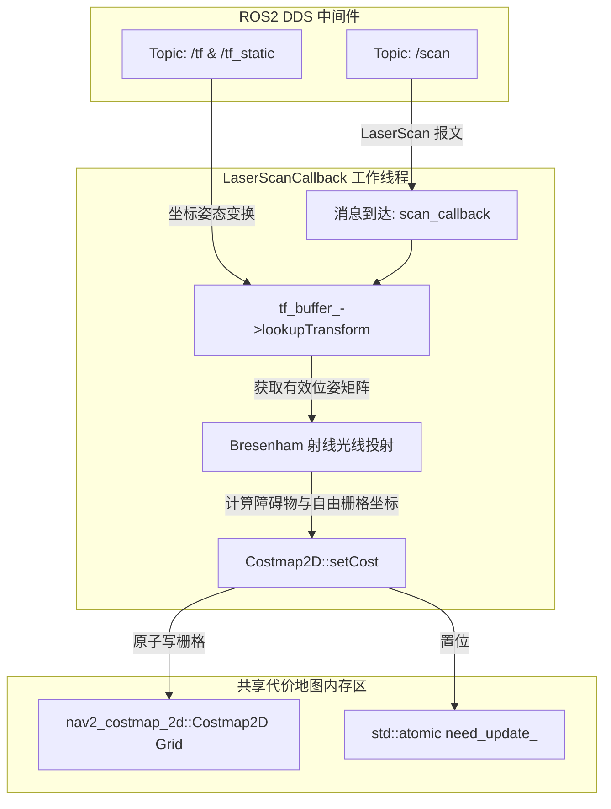
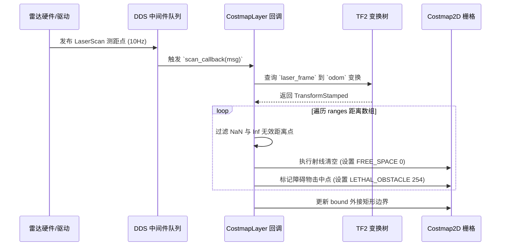
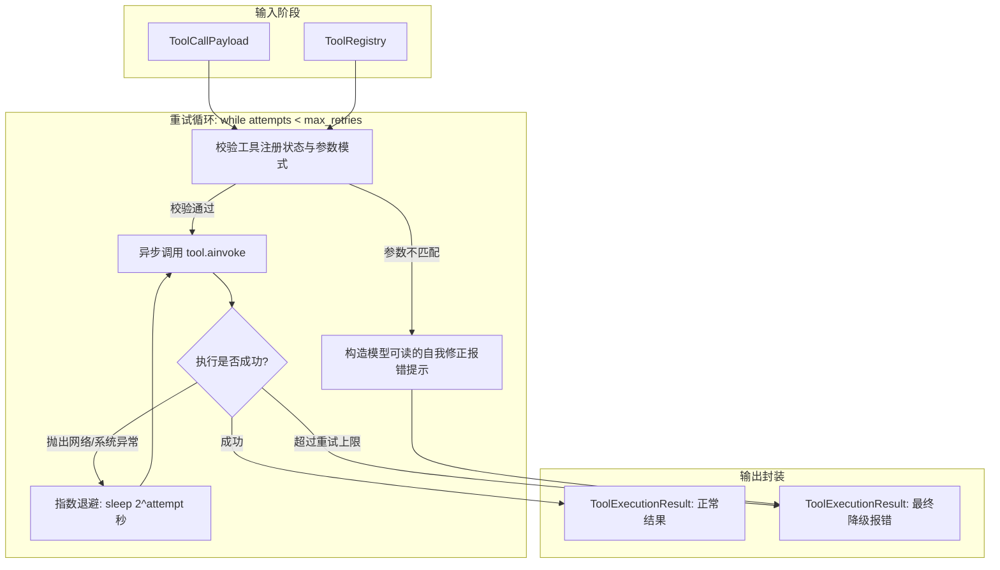

# 四层解读 —— 「逻辑」视角指令 (Logic Perspective)

## 本层定位
「逻辑」视角的核心任务是抽丝剥茧地解析选中代码的数据流动过程与算法运转机理，强调输入与输出、数据流向图、精确执行步骤、算法推导及具象变量追踪追踪例子。本层是理解代码「如何跑通」的关键基石。

## 篇幅与结构要求
- **篇幅下限**：标准模式 1000–2500 字；深度模式 2000–4000 字。必须达到篇幅下限，详细展开，杜绝敷衍。
- **输出格式**：纯 Markdown 格式，严格包含以下 6 个固定二级标题（不得遗漏或更改标题名称）：
  1. `## 输入与输出`：使用 Markdown 表格，字段包括：【名称】、【类型】、【来源或去向】、【技术含义】、【典型示例值】。必须同时覆盖显式输入输出（入参、返回值）与隐式输入输出（类成员状态、ROS 订阅话题/参数服务器、环境变量、系统时钟，以及发布的 ROS 话题、文件/网络 I/O、日志输出）。
  2. `## 数据流向图`：必须提供一张严谨的 ```mermaid flowchart 图表。节点必须使用真实代码变量名、函数名、话题名，连接线上必须标注传递的数据格式与语义。涉及跨节点、跨文件或跨线程时，必须使用 `subgraph` 分区展示。涉及异步回调或多阶段网络通信时，需补充一张 sequenceDiagram 时序图。图表下方用 2–3 句话说明如何按图索骥阅读该数据流。
  3. `## 运行逻辑`：按实际执行先后顺序进行递增编号（1., 2., 3. ...），每个步骤必须显式带上代码行号（如 `[L15-L22]`），清晰交代「做了什么」、「为什么这么做」、「结果暂存或落盘到何处」。异步回调或事件监听函数需特别说明其触发时机、驻留的线程模型或执行器模式（如 SingleThreadedExecutor、asyncio 事件循环）。
  4. `## 算法介绍`：明确标出所用算法名称。若无高阶数学算法，则严格剖析其底层的编排模式（如状态机 State Machine、发布-订阅 Publish-Subscribe、生产者-消费者 RingBuffer、重试熔断器 CircuitBreaker）。分步介绍核心推演思路，明确标出时间复杂度与空间复杂度，解释为何选择该设计及常见替代方案。
  5. `## 简单例子`：构造一组具体的输入参数与前置状态，使用 Markdown 表格逐行、逐步追踪核心变量、内部计数器在每个阶段的值变化，直到最终返回；随后给出一个边界或异常例子（如空数据、越界值、超时），说明代码将进入哪个守卫分支。
  6. `## 分支与异常`：逐一列出选区中所有 `if-else` 条件判断、`try-catch` 异常捕获、`early-return` 边界防护，分析其触发条件、保护目的以及触发后的回退路径。
- **代码引用规则**：所有涉及具体代码的表述必须标注行号 `[Lxx-Lyy]` 或 `[path:Lxx-Lyy]`。
- **概念词输出**：回答末尾单独一行输出 `<!-- concepts: 概念1, 概念2, ... -->`。
- **严禁套话**：严禁出现「实现了相关功能」「处理相关业务」「等等」等无实际语义词汇。

---

## 完整示范 1：ROS2 C++ (Subscribed Costmap Updater 局部代价地图更新)

## 输入与输出
| 名称 | 类型 | 来源或去向 | 技术含义 | 示例值 |
| :--- | :--- | :--- | :--- | :--- |
| `msg` (显式) | `sensor_msgs::msg::LaserScan::ConstSharedPtr` | 隐式来源: 激光雷达驱动节点发布的 `/scan` 话题 | 激光测距点云数组，包含测距角度范围与距离点阵 | `ranges = [1.25, 1.28, inf, 0.95, ...]` |
| `costmap_` (隐式输入/输出) | `nav2_costmap_2d::Costmap2D*` | 成员变量，内存缓冲区 | 当前局部网格代价地图，存储栅格代价值 `0~255` | `size_x=200, size_y=200, res=0.05` |
| `tf_buffer_` (隐式输入) | `std::shared_ptr<tf2_ros::Buffer>` | 隐式来源: `/tf` 话题监听缓存 | 坐标变换查询器，计算传感器坐标系到世界坐标系的变换矩阵 | `laser_frame -> odom` |
| `need_update_` (隐式输出) | `std::atomic<bool>` | 成员变量，向主规划线程广播信号 | 标记当前代价网格已脏，通知全局/局部路径规划器重新计算 | `true` |

## 数据流向图



> **图表导读**：上图清晰勾勒了激光雷达数据流从 DDS 话题传输到节点，结合坐标变换树（TF2），通过光线投射算法最终写入代价网格并通知主规划器重绘的全链路流向。

## 运行逻辑
1. `[L24-L28]` **消息捕获与安全校验**：当激光驱动通过 DDS 广播点云时，`scan_callback(msg)` 在执行器线程池中被激活。代码首先检查智能指针有效性，确保 `msg` 非空。
2. `[L30-L38]` **坐标系时钟校准与姿态变换获取**：调用 `tf_buffer_->lookupTransform("odom", msg->header.frame_id, msg->header.stamp, 50ms)`。若在指定 50ms 超时内未能完成时间同步，则进入告警分支，跳过此帧更新，避免在未知坐标系下将障碍物错误投射。
3. `[L42-L55]` **距离数据清洗与极限过滤**：遍历 `msg->ranges` 向量数组，计算对应极坐标系的角度 `angle = angle_min + i * angle_increment`。代码过滤掉小于 `range_min`（传感器近端盲区）或大于 `range_max` 的数值。对于无穷大 `inf`，标记为最大量程内的开阔自由空间。
4. `[L58-L76]` **栅格坐标映射与光线投射**：将极坐标点通过位姿变换转换为世界坐标系下的连续物理坐标 `(x, y)`，再利用栅格分辨率 `resolution` 换算为整数索引 `(mx, my)`。调用 Bresenham 算法对起点到障碍点沿途的栅格批量置为 `FREE_SPACE (0)`，将末端命中点置为 `LETHAL_OBSTACLE (254)`。
5. `[L80-L86]` **脏矩形标记与通知**：将修改过的栅格坐标合入局部更新包围盒 `(min_x, min_y, max_x, max_y)`，最后通过 `need_update_.store(true, std::memory_order_release)` 原子置位，确保多线程内存可见性。

## 算法介绍
- **算法名称**：**Bresenham 射线追踪算法 (Bresenham's Line-Raycasting Algorithm)**。
- **解决问题**：在离散二维栅格网络中，快速计算从激光发射源点到探测障碍物击中点之间连线所穿过的所有离散格子，用于消除历史残留的伪障碍物。
- **核心逻辑**：采用整数增量与误差累积项判断下一个最佳逼近栅格，完全避免了浮点数乘除法运算。
- **复杂度分析**：
  - **时间复杂度**：$O(N \cdot L)$，其中 $N$ 为每帧激光束条数（通常 360–1080 束），$L$ 为射线覆盖的网格跨距长度。
  - **空间复杂度**：$O(1)$，直接在已有网格二维数组上进行指针原地寻址与数值写入。
- **选择原因与替代方案**：传统基于浮点 DDA 算法在嵌入式车载电脑（如 Jetson Orin）上 CPU 损耗过高。Bresenham 全整数运算法效率高出近 3 倍；替代方案如分级八叉树/四叉树（OctoMap）虽然利于压缩三维空间，但在 2D 导航场景中带来不必要的指针跳跃与内存碎片。

## 简单例子
**场景设定**：小车位于原点 `(0, 0)`，前方激光测距仪在 0 弧度方向检测到一个障碍物，距离为 `0.15m`。栅格分辨率 `0.05m`，网格当前默认代价值均为 `UNKNOWN (255)`。
| 执行步数 | 遍历射线格子 | 计算出的栅格坐标 `(mx, my)` | 执行操作 | 栅格代价值变化 | 说明 |
| :--- | :--- | :--- | :--- | :--- | :--- |
| Step 1 | 起点 (0m) | `(0, 0)` | 设置自由区域 | $255 \rightarrow 0$ | 传感器源点无障碍 |
| Step 2 | 沿途 1 (0.05m) | `(1, 0)` | 设置自由区域 | $255 \rightarrow 0$ | 光束穿透区域 |
| Step 3 | 沿途 2 (0.10m) | `(2, 0)` | 设置自由区域 | $255 \rightarrow 0$ | 光束穿透区域 |
| Step 4 | 终点 (0.15m) | `(3, 0)` | 标记致命障碍 | $255 \rightarrow 254$ | 激光束命中真实物体 |

**边界例子（雷达被遮挡返回 0 距离）**：若输入 `range = 0.01m < msg->range_min`，判断命中 `[L44]` 校验分支，该射线被丢弃，不执行光线投射，防止因雷达防尘罩反光将小车自身位置误判为致命障碍。

## 分支与异常
1. `[L32-L36]` **TF 变换超时异常 (`tf2::TransformException`)**：当主板高负载导致 TF 广播延迟时捕获该异常，使用 `RCLCPP_WARN_THROTTLE` 限频输出报警日志，并丢弃当前帧数据，防止脏坐标进入地图系统。
2. `[L43-L47]` **盲区数据过滤 (`if (r < range_min || r > range_max)`)**：防范物理传感器硬件异常噪点。
3. `[L62-L65]` **越界边界校验 (`if (!worldToMap(x, y, mx, my))`)**：如果激光打到了局部地图边界之外的建筑，`worldToMap` 返回 `false`，代码立即截断射线，防止产生数组越界段错误（Segmentation Fault）。

<!-- concepts: Costmap2D, Bresenham Algorithm, LaserScan, TF2 Transform, Thread Synchronization -->

---

## 完整示范 2：大模型应用 Python (Agent 工具重试与执行器)

## 输入与输出
| 名称 | 类型 | 来源或去向 | 技术含义 | 示例值 |
| :--- | :--- | :--- | :--- | :--- |
| `tool_call` (显式) | `ToolCallPayload` (Pydantic 模型) | 大模型输出解析器提取的函数调用请求 | 包含工具名称与 JSON 格式的序列化实参 | `name="fetch_weather", args={"city": "Beijing"}` |
| `registry` (显式) | `ToolRegistry` | 外部注入的可用工具字典集合 | 存储所有已注册安全工具的可调用闭包及元数据 | `{"fetch_weather": <WeatherToolInstance>}` |
| `max_retries` (显式) | `int` | 配置项 / 可选入参 | 工具网络失败或模型参数不合规时的最大自动重试上限 | `3` |
| `result` (返回值) | `ToolExecutionResult` | 向下游对话历史追加的工具返回包 | 包含成功状态、字符串化结果输出或格式化异常信息 | `success=True, output="18°C 晴", latency_ms=230` |

## 数据流向图

> **图表导读**：展现了智能体执行工具时的校验、动态重试、指数退避延迟计算与最终结果组装的完整状态流转。

## 运行逻辑
1. `[L12-L18]` **工具合法性预检**：通过 `registry.get(tool_call.name)` 检索目标工具。若未注册，直接返回 `ToolExecutionResult(success=False, output="Error: Tool not found")`，不浪费网络调用。
2. `[L20-L28]` **参数校验与反序列化**：通过 Pydantic 模型的 `model_validate_json` 解析 JSON 实参字符串。若模型输出的 JSON 残缺或缺少必填字段，捕获 `ValidationError` 并将具体缺失字段结构化格式化，提示模型修正入参。
3. `[L30-L45]` **带指数退避的异步重试循环**：初始化 `attempt = 0`。在 `while attempt < max_retries` 内发起 `await tool.ainvoke(args)`。每次捕获到可恢复的连接或速率限制异常（如 `RateLimitError`, `TimeoutError`）时，计算休眠时间 $t = 2^{\text{attempt}} + \text{jitter}$ 并执行 `await asyncio.sleep(t)`。
4. `[L48-L55]` **执行结果标准化与耗时统计**：统计整个流程的毫秒耗时 `latency_ms`。成功则序列化返回值；失败达到上限则返回降级文案，保证智能体上下文不会因 Python 未捕获异常而崩溃断开。

## 算法介绍
- **算法名称**：**全抖动指数退避算法 (Full Jitter Exponential Backoff)**。
- **解决问题**：在高并发大模型智能体执行多工具调度时，避免瞬时网络抖动或远端 API 限流（429 Too Many Requests）导致的大规模重试并发碰撞（雪崩效应）。
- **核心逻辑**：
  $$\text{delay} = \text{random}(0, \; \text{min}(\text{max\_delay}, \; \text{base\_delay} \times 2^{\text{attempt}}))$$
- **复杂度分析**：
  - **时间复杂度**：最坏情况下为 $O(\sum_{k=1}^M 2^k) = O(2^M)$，其中 $M$ 为重试上限次数（通常设为 3，故延迟上限可控）。
  - **空间复杂度**：$O(1)$，仅在局部函数栈中维系计数与休眠计时器。

## 简单例子
**场景设定**：模型调用天气查询接口，第一次遭遇网络连接超时，第二次成功返回数据。
| 尝试轮次 | 阶段状态 | 事件行为 | 核心变量状态 |
| :--- | :--- | :--- | :--- |
| 第 1 次尝试 | `attempt=0` | 发起 `http.get`，因网络丢包触发 `TimeoutError` | `is_retryable=True` |
| 退避休眠 | 退避计算 | 计算延迟 $t = \text{random}(0, 2^0) = 0.6\text{s}$ | `await asyncio.sleep(0.6)` |
| 第 2 次尝试 | `attempt=1` | 重发请求，接口响应 200 OK | `output="{\"temp\": 22}"`, `success=True` |
| 最终输出 | 返回封装 | 退出重试循环，组装最终对象 | `ToolExecutionResult(latency_ms=850)` |

**边界例子（格式错误不可重试）**：若模型传入非法 JSON `args="{'city': "`，在预检阶段即被 Pydantic 拒绝，代码直接判定为非重试错误（Non-retryable），立即返回错误提示，避免反复执行无效网络重试。

## 分支与异常
1. `[L15-L18]` **未注册工具早退**：防止非法名称注入执行未定义逻辑。
2. `[L22-L26]` **参数结构校验分支 (`ValidationError`)**：给大模型提供准确的 Schema 差异反馈。
3. `[L38-L42]` **异常分类匹配 (`except Exception as exc`)**：区分为客户端不可恢复错误与远端服务端可恢复重试错误。

<!-- concepts: Tool Loop, Exponential Backoff, Jitter, Pydantic Validation, asyncio -->
