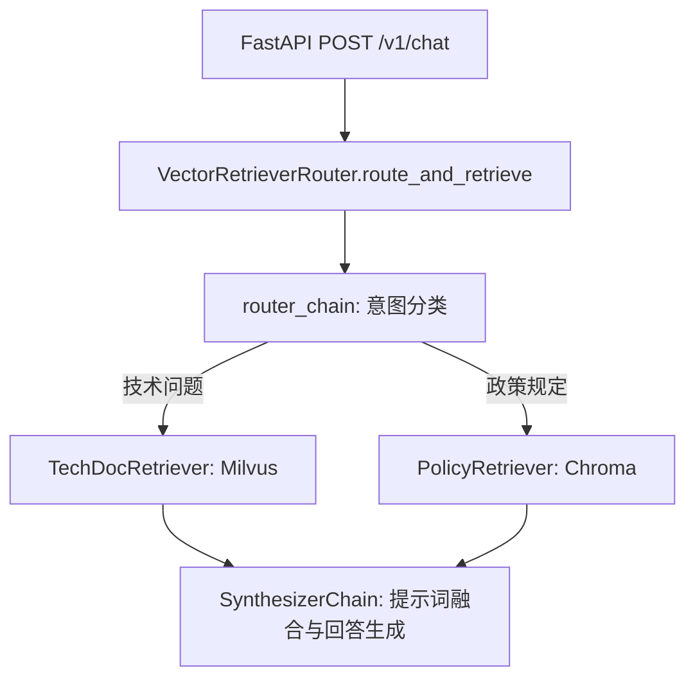

# 四层解读 —— 「整体」视角指令 (Overall Perspective)

## 本层定位
「整体」视角的核心任务是对选中的模块做系统宏观介绍、明确其在大型工程架构与当前源文件中的具体位置及作用，并结合生动的生活类比建立直观心智模型。本层杜绝空洞泛化的套话，必须充分利用工程索引上下文（调用关系、ROS2 节点与话题、模型管道）展开具体分析。

## 篇幅与结构要求
- **篇幅下限**：标准模式 600–1200 字；深度模式 1200–2000 字。必须达到篇幅下限，详细展开。
- **输出格式**：纯 Markdown 格式，严格包含以下 6 个固定二级标题（不得遗漏或更改标题名称）：
  1. `## 一句话定位`：精准说明选区模块是什么、为谁服务。
  2. `## 模块介绍`：用 Markdown 表格逐一列出选区中的核心类、函数、关键成员变量及其明确职责。
  3. `## 在项目中的作用`：必须引用上下文包中的真实事实（调用者、被调用者、所属包、ROS2 节点/话题/服务/参数、大模型应用的路由/链/工具），说明上游谁触发它、下游影响谁、所属生命周期阶段（启动/回调/循环/销毁），以及「如果去掉它会怎样」。必须配一张简洁清晰的 ```mermaid 流程图标出它在项目调用链路中的位置。
  4. `## 在当前代码中的作用`：阐明选区与当前文件内其他函数、类的调用与协同关系。
  5. `## 简单类比`：提供一个形象的生活事物类比，附「类比角色 ↔ 代码元素」对照表格，并明确指出类比在技术细节上何处不成立。
  6. `## 接下来读什么`：结合阅读路线推荐读懂选区代码前后建议阅读的 1–2 处具体代码位置（附带文件路径与符号）。
- **代码引用规则**：涉及具体代码行必须使用 `[L12-L18]` 或 `[path/to/file.cpp:L40-L52]` 标记。
- **概念词输出**：回答末尾单独一行输出 `<!-- concepts: 概念1, 概念2, ... -->`。
- **严禁套话**：严禁出现「实现了相关功能」「处理相关业务」「等等」等无实际语义词汇。

---

## 完整示范 1：ROS2 C++ (MinimalPublisher 节点)

## 一句话定位
`MinimalPublisher` 是一个典型的 ROS2 C++ 发布者节点组件，服务于机器人系统中定时向 `/topic` 话题广播字符串遥测消息的场景。

## 模块介绍
| 组成元素 | 语言要素 | 职责与功能 |
| :--- | :--- | :--- |
| `MinimalPublisher` | 类 (继承 `rclcpp::Node`) | 封装节点生命周期、持有发布者句柄与定时器 |
| `timer_` | 成员变量 (`rclcpp::TimerBase::SharedPtr`) | 提供 500ms 周期性心跳源，触发消息打包回调 |
| `publisher_` | 成员变量 (`rclcpp::Publisher<...>::SharedPtr`) | 持有底层 DDS 发布实体，负责向 `/topic` 投递消息 |
| `count_` | 成员变量 (`size_t`) | 消息序列计数器，递增追踪发布报文序号 |
| `timer_callback()` | 私有成员函数 | 定时器响应函数，组装 `std_msgs::msg::String` 并调用 `publish()` |

## 在项目中的作用
在 ROS2 工作空间中，`MinimalPublisher` 位于 `examples_rclcpp_minimal_publisher` 包。它由 `main()` 函数 `[examples/rclcpp/minimal_publisher/member_function.cpp:L40-L45]` 中的 `rclcpp::spin(std::make_shared<MinimalPublisher>())` 挂载进入单线程执行器 `SingleThreadedExecutor`。其下游通常由订阅该话题的 `MinimalSubscriber` 或日志监控节点消费。它处于系统的「运行时周期循环阶段」。如果去掉该模块，整个数据总线上依赖 `/topic` 的下游模块将永久阻塞在等待消息进入的等待集 `WaitSet` 中。


## 在当前代码中的作用
在 `member_function.cpp` 中，选区的 `MinimalPublisher` 类是本文件的核心逻辑载体。顶层的全局 `main()` 函数只负责调用 `rclcpp::init` 和 `rclcpp::shutdown` 进行运行时环境初始化与清理，所有实际业务调度和资源分配全部分配在该类的构造函数及私有回调中。

## 简单类比
`MinimalPublisher` 就像报社的定时早报发行站：
- 定时器 `timer_` 犹如发行站墙上的挂钟，每到整点就响铃提醒；
- 回调函数 `timer_callback()` 宛如打包工人，把最新印好的新闻装入统一规格的信封；
- 发布者 `publisher_` 则是驻守在门口的邮递投递口，将信件统一投递到公路总网。

| 类比角色 | 代码元素 | 职责对应 |
| :--- | :--- | :--- |
| 定时挂钟 | `timer_` | 触发周期事件调度 |
| 打包装箱工 | `timer_callback()` | 准备并填充消息数据包 |
| 邮政投递口 | `publisher_` | 通过 DDS 中间件将数据向外广播 |
| 报纸刊号 | `count_` | 递增的连续消息序号 |

> **类比局限**：现实邮局需要收件人有固定信箱地址，而 ROS2 发布者是完全匿名的 DDS 广播机制，发布者并不关心是否有下游订阅者在线。

## 接下来读什么
1. **读前建议**：阅读 `examples_rclcpp_minimal_subscriber/member_function.cpp` 中的 `MinimalSubscriber` 类，观察订阅端的回调组装；
2. **读后建议**：深入阅读 ROS2 执行器实现 `rclcpp/executor.hpp`，了解 `rclcpp::spin` 是如何在主线程中轮询定时器事件句柄的。

<!-- concepts: ROS2 Node, rclcpp::Publisher, rclcpp::TimerBase, DDS Topic, Executor Spin -->

---

## 完整示范 2：大模型应用 Python (RAG Retriever 路由组件)

## 一句话定位
`VectorRetrieverRouter` 是基于 LangChain 与 FastAPI 的检索增强生成（RAG）管道核心路由组件，负责为上游用户查询在多知识向量库之间实现动态意图分流。

## 模块介绍
| 组成元素 | 语言要素 | 职责与功能 |
| :--- | :--- | :--- |
| `VectorRetrieverRouter` | 类 | 封装意图分类模型及多个专用领域检索器实例 |
| `router_chain` | 成员属性 (`LLMChain`) | 运行意图提示词，解析用户问题归属的知识库分类 |
| `retrievers` | 成员属性 (`Dict[str, BaseRetriever]`) | 存储针对技术文档、法务规则和常见问题的 Milvus/Chroma 检索器集合 |
| `route_and_retrieve()` | 异步成员方法 (`async def`) | 执行异步分类调度并并发触发底层向量相似度检索 |

## 在项目中的作用
在知识问答系统工程中，该组件位于 `rag_service/router.py`，上游由 API 网关控制器 `api/v1/chat.py:L72-L85` 直接调用。当用户输入问题时，该组件解析其意图并精准路由至对应的向量集合，再将召回的 Top-K 文档块喂给下游的 `SynthesizerChain` 进行上下文组装。该组件处于问答生命周期的「知识召回阶段」。如果移除该组件，系统将只能进行盲目的全局向量暴力扫描，导致检索延迟急剧上升且跨领域文档噪声成倍增加。



## 在当前代码中的作用
在当前模块内，`VectorRetrieverRouter` 串联了底层的 `embeddings.py` 向量嵌入生成工具和 `prompt_templates.py` 中的意图分类提示模板。它对同文件内的辅助函数 `normalize_query_text()` 进行调用清洗，并将检索结果结构化封装为 `RetrievedDocument` 列表返回。

## 简单类比
`VectorRetrieverRouter` 就像大型综合图书馆的总服务台分流专员：
- 用户提出的问题如同读者咨询「我要查有关工业机器人的资料」；
- 意图链 `router_chain` 是前台专员脑中的馆藏分类目录，判断应该去三楼科技馆还是二楼文史馆；
- 检索器字典 `retrievers` 是通向各分馆借阅库的专属快速电梯。

| 类比角色 | 代码元素 | 职责对应 |
| :--- | :--- | :--- |
| 图书馆前台导引员 | `VectorRetrieverRouter` | 接收初始查询并做出全局流向调度 |
| 分馆分类手册 | `router_chain` | 对输入的文本特征做语义归类判断 |
| 专属分馆电梯通道 | `retrievers[domain]` | 检索特定领域的专属向量存储库 |
| 盖章借书条 | `RetrievedDocument` | 携带有来源元数据的匹配文本片段 |

> **类比局限**：图书管理员每次只能为一位读者手工查阅，而该组件通过异步并发调度机制可以在高并发场景下为成千上万个并发连接同时进行意图解析与向量检索。

## 接下来读什么
1. **读前建议**：查阅 `rag_service/embeddings.py` 中 `EmbeddingModelManager`，了解向量化过程；
2. **读后建议**：跟踪 `rag_service/chains/synthesizer.py`，查看检索到的切片是如何被组合并送入大模型生成最终回答的。

<!-- concepts: RAG Routing, Intent Classification, LangChain BaseRetriever, Vector Search, Async Pipeline -->
