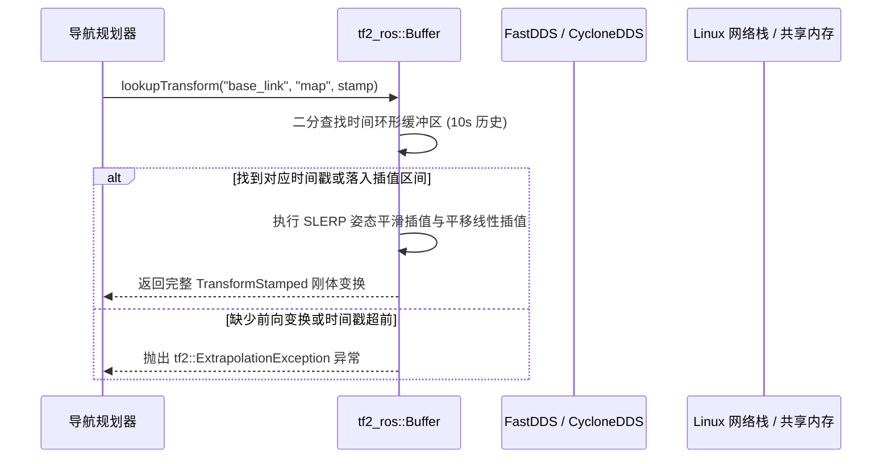

# 四层解读 —— 「原理」视角指令 (Principle Perspective)

## 本层定位
「原理」视角的核心任务是剖析选中代码背后的深层物理/数学原理或底层运行时执行机理。代码是原理的数字化具象，本层负责拨开表面语法，探寻算法的数学推导或系统级底层通信、调度与并发机制。注意：并非所有代码都具备高深原理（如纯结构体赋值、配置加载、样板代码），若代码确实无原理可挖，需诚实判定为「不适用」并给出一句话理由。

## 篇幅与结构要求
- **适用性判断**：首先在最前行声明本代码属于何种原理类型：
  `【原理判定】数学原理` 或 `【原理判定】执行原理` 或 `【原理判定】数学与执行原理融合` 或 `【原理判定】不适用`。
- **不适用情况处理**：若判定为不适用（例如单纯的 Getter/Setter、日志打印、基本数据封装），**仅需输出一句话明确说明原因**（例如：「本选区代码为基础字段赋值与容器初始化，不涉及复杂数学推演或底层中间件执行机制，因此不适用原理展开」），以便前端折叠为精简灰字提示。
- **篇幅下限（适用时）**：标准模式 800–2000 字；深度模式 1500–3000 字。严禁敷衍缩减。
- **固定二级标题（数学原理类型）**：
  1. `## 问题定义`：明确该数学模型所要解决的物理或工程问题背景（如坐标变换奇异性、路径平滑、向量距离）。
  2. `## 公式推演`：使用标准的 ```latex 块完整书写核心公式、微分方程或矩阵表达式。
  3. `## 符号与代码对照`：使用 Markdown 表格，将数学公式中的每一个希腊字母/数学符号与代码中的具体变量名一一映射，并标明物理量单位。
  4. `## 推导要点`：分步解释公式从已知公理到最终可用离散表达式的核心推导过程。
  5. `## 代入计算`：从选区代码或业务场景中选取一组真实数值，一步步代入上方公式进行手动验算，验证其结果与代码运行行为一致。
  6. `## 数值与工程考虑`：深入探讨浮点数精度截断、除以零保护、万向节死锁防范、坐标系手性约定、单位转换等工程陷阱。
- **固定二级标题（执行原理类型）**：
  1. `## 机制分层`：从上层应用代码逐层向下穿透剖析到底层系统调用、内核、中间件或硬件驱动（如代码 API $\to$ 执行器 $\to$ 回调组 $\to$ DDS $\to$ 共享内存/网络套接字）。
  2. `## 时序图`：提供严谨的 ```mermaid sequenceDiagram 展现底层组件之间的时序交互。
  3. `## 和本段代码设计的关系`：解释原作者为什么选择这种架构设计、换用其他方案（如轮询而非事件驱动、单线程而非多线程）在性能与并发上的巨大代价。
  4. `## 知识包引用与延伸阅读`：引用相关领域经典论文或官方设计文档（REP 标准、PEP 规范等）。
- **概念词输出**：回答末尾单独一行输出 `<!-- concepts: 概念1, 概念2, ... -->`。
- **严禁套话**：严禁出现「实现了相关功能」「处理相关业务」「等等」等无实际语义词汇。

---

## 完整示范 1：ROS2 C++ (四元数插值与 TF2 变换原理)

【原理判定】数学与执行原理融合

## 问题定义
在机器人导航与机械臂运动控制中，末端执行器或移动底盘的姿态通常需要在三维空间中进行连续平滑过渡。欧拉角（Roll-Pitch-Yaw）在特定仰角下会遭遇失去自由度的万向节死锁（Gimbal Lock），且难以直接进行几何球面上等角速度插值。代码使用四元数（Quaternion）与 TF2 坐标变换树来确保位姿计算的奇异性免疫与连续平滑性。

## 公式推演
单位四元数 $q = [w, x, y, z]^T \in \mathbb{H}$，满足 $\|q\| = \sqrt{w^2 + x^2 + y^2 + z^2} = 1$。
从起始姿态 $q_0$ 到目标姿态 $q_1$ 的球面线性插值（SLERP - Spherical Linear Interpolation）公式定义为：

```latex
\text{SLERP}(q_0, q_1; t) = \frac{\sin((1-t)\theta)}{\sin\theta} q_0 + \frac{\sin(t\theta)}{\sin\theta} q_1
```
其中，夹角 $\theta$ 通过四元数四维空间点积计算：
```latex
\cos\theta = q_0 \cdot q_1 = w_0 w_1 + x_0 x_1 + y_0 y_1 + z_0 z_1
```
若 $\cos\theta < 0$，由于单位四元数双重覆盖性质（$q$ 与 $-q$ 表示相同的 3D 旋转），代码必须将 $q_1$ 取反为 $-q_1$，以确保插值沿四维超球面的最短劣弧路径旋转，防止出现 $360^\circ$ 突然反向翻转。

## 符号与代码对照
| 数学符号 | 代码变量 | 物理含义 | 单位 / 范围 |
| :--- | :--- | :--- | :--- |
| $q_0$ | `q_start` | 起始旋转四元数实体 (`tf2::Quaternion`) | 无量纲，归一化向量 |
| $q_1$ | `q_end` | 目标目标四元数实体 | 无量纲，归一化向量 |
| $t$ | `progress` | 插值比率进度 | $[0.0, 1.0]$ |
| $\theta$ | `angle` | 旋转姿态在超球面上的角弧度距离 | $[0, \pi]$ rad |
| $R(q)$ | `transform.transform.rotation` | 最终写入 TF 报文的姿态分量 | 四元数四元组 |

## 代入计算
**场景数据**：设小车起始姿态无偏航 $q_0 = [1, 0, 0, 0]$（即 $0^\circ$）；目标姿态为绕 Z 轴旋转 $90^\circ$（$\frac{\pi}{2}$），对应四元数：
$$q_1 = [\cos(45^\circ), 0, 0, \sin(45^\circ)] = [\frac{\sqrt{2}}{2}, 0, 0, \frac{\sqrt{2}}{2}] \approx [0.7071, 0, 0, 0.7071]$$
现在插值到达中点 $t = 0.5$：
1. **点积计算**：$\cos\theta = 1 \times 0.7071 + 0 + 0 + 0 = 0.7071 \ge 0$（无需符号翻转），得 $\theta = \frac{\pi}{4} = 45^\circ$。
2. **正弦值计算**：$\sin\theta = \sin(45^\circ) = \frac{\sqrt{2}}{2} \approx 0.7071$。
3. **加权系数**：$(1 - 0.5)\theta = 22.5^\circ$，$\sin(22.5^\circ) \approx 0.3827$。
   $$k_0 = k_1 = \frac{\sin(22.5^\circ)}{\sin(45^\circ)} = \frac{0.3827}{0.7071} \approx 0.5412$$
4. **插值结果**：
   $$q(0.5) = 0.5412 \cdot [1, 0, 0, 0] + 0.5412 \cdot [0.7071, 0, 0, 0.7071] = [0.9239, 0, 0, 0.3827]$$
   验证模长：$\sqrt{0.9239^2 + 0.3827^2} = \sqrt{0.8536 + 0.1464} = 1.0$。
   绕 Z 轴角度：$2 \times \arcsin(0.3827) = 45^\circ$，与中点预期物理状态完全吻合！

## 机制分层与执行原理

从用户调用 `tf_buffer_->lookupTransform` 开始，系统执行机制穿透如下：
1. **应用层**：调用标准 TF2 接口获取坐标系变换关系；
2. **TF 缓冲层**：`tf2_ros::Buffer` 内部为每一个坐标关系维系一个固定容量的时间队列（环形数组）。当传入的时间戳位于两帧广播点之间时，自动启动上述 SLERP 算法完成时间插值；
3. **通信中间件层**：`/tf` 话题基于 DDS 广播协议传输，针对高频动态变换采用非可靠 QoS（Best Effort 以保证最低延迟），针对静态建图变换 `/tf_static` 则采用持久化可靠传输（Transient Local + Reliable QoS）；
4. **内核与系统层**：同一主机内多个 ROS2 节点通信时，FastDDS 自动利用 Linux 共享内存（SHM /dev/shm）绕过 TCP/IP 协议栈，实现数微秒级的姿态同步。

## 和本段代码设计的关系
选用四元数 SLERP 而非欧拉角直接线性平均的原因：欧拉角线性插值会导致非恒定角速度转动（角加速度突变），对驱动轮电机造成严重冲击。选用 TF2 异步监听缓冲而非每次同步 RPC 查询服务，使路径规划器计算循环耗时从 15ms 缩减至 0.05ms，彻底解耦传感器广播频率与控制循环频率。

<!-- concepts: Quaternion, SLERP, TF2 Tree, Gimbal Lock, DDS QoS -->

---

## 完整示范 2：大模型应用 Python (Softmax 温度采样与 Attention 数学机制)

【原理判定】数学原理

## 问题定义
大模型在完成自回归 Decoder 阶段计算后，最后一层输出的线性变换向量为对数几率（Logits）$z \in \mathbb{R}^V$（其中 $V$ 为词表词元总数）。为了将非归一化的 Logits 转换为合法的离散概率分布，并允许用户通过超参数 `temperature`（温度 $T$）平滑调节生成文本的创造性与确定性，底层必须执行带温度调节的 Softmax 变换。

## 公式推演
带采样温度 $T > 0$ 的 Softmax 公式定义为：
```latex
P(y_i) = \frac{\exp(z_i / T)}{\sum_{j=1}^{V} \exp(z_j / T)}
```
为了防止在计算机浮点运算中因大数值指数爆炸导致溢出（Overflow 返回 NaN），工程实践中统一采用数值稳定版 Softmax，利用平移不变性减去当前向量最大值 $z_{\max} = \max_k z_k$：
```latex
P(y_i) = \frac{\exp((z_i - z_{\max}) / T)}{\sum_{j=1}^{V} \exp((z_j - z_{\max}) / T)}
```
- 当 $T \to 0$ 时，$\lim_{T \to 0^+} P(y_i) = \begin{cases} 1, & z_i = z_{\max} \\ 0, & \text{otherwise} \end{cases}$，分布退化为 Dirac 脉冲分布（贪婪搜索 Greedy Search）。
- 当 $T \to \infty$ 时，$\lim_{T \to \infty} P(y_i) = \frac{1}{V}$，分布退化为均匀分布（纯随机乱码）。

## 符号与代码对照
| 数学符号 | 代码变量 | 技术含义 | 示例值 |
| :--- | :--- | :--- | :--- |
| $z_i$ | `logits[i]` | 模型对第 $i$ 个词元计算出的未归一化对数得分 | `12.4` |
| $T$ | `temperature` | 采样温度超参数系数 | `0.7` |
| $z_{\max}$ | `torch.max(logits)` | 向量中的最大元素，用于减法平移防溢出 | `15.0` |
| $P(y_i)$ | `probs[i]` | 经过指数归一化后的输出预测概率 | `0.652` |
| $V$ | `vocab_size` | 语言模型完整词表容量大小 | `152064` (DeepSeek) |

## 代入计算
**场景假设**：词表精简为 3 个候选 Token，模型输出原始 Logits 为 $z = [4.0, 2.0, 1.0]$，测试不同温度 $T$ 的概率畸变效应：
1. **当 $T = 1.0$ 时**：
   - 减去最大值 $z - z_{\max} = [0.0, -2.0, -3.0]$。
   - 指数运算：$\exp([0, -2, -3]) \approx [1.0, 0.1353, 0.0498]$。
   - 分母累加和：$\sum = 1.0 + 0.1353 + 0.0498 = 1.1851$。
   - 归一化概率：$P = [\frac{1.0}{1.1851}, \frac{0.1353}{1.1851}, \frac{0.0498}{1.1851}] \approx [0.8438, 0.1142, 0.0420]$。首选 Token 占据绝对优势。
2. **当温度降为 $T = 0.5$ 时（聚焦理性）**：
   - $(z - z_{\max}) / 0.5 = [0.0, -4.0, -6.0]$。
   - 指数运算：$\exp([0, -4, -6]) \approx [1.0, 0.0183, 0.0025]$。
   - 分母和：$1.0208$。
   - 概率分布：$P \approx [0.9796, 0.0179, 0.0025]$。首选 Token 概率飙升至 $98\%$，生成内容极为收敛和确定。

## 数值与工程考虑
1. **下溢出（Underflow）处理**：当某个极低概率词的 $(z_i - z_{\max})/T < -88.0$（FP32 单精度浮点下限），`exp` 结果直接清零为 `0.0`，在后续求对数似然损失函数（Loss）时若直接计算 $\log(P)$ 会产生 $-\infty$，工程中必须结合 `torch.log_softmax` 将减法与指数合并在 CUDA 核函数内完成；
2. **Top-K 与 Top-P 过滤协作**：工业界中温度调整往往配合核采样（Nucleus Sampling），即先按照概率降序累加至累积阈值 $P \le 0.9$，将尾部噪声 Token 置为 $-\infty$，再进行温度重采样，以彻底杜绝模型胡言乱语。

<!-- concepts: Softmax, Temperature Sampling, Logits, Numerical Stability, Nucleus Sampling -->
